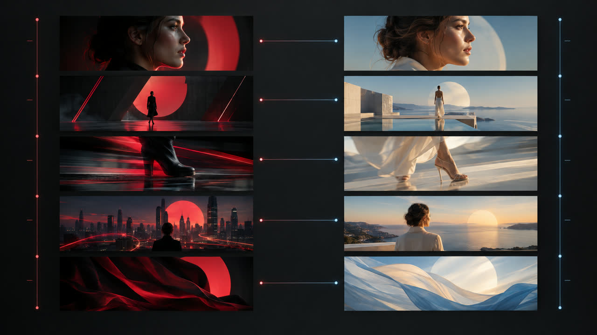
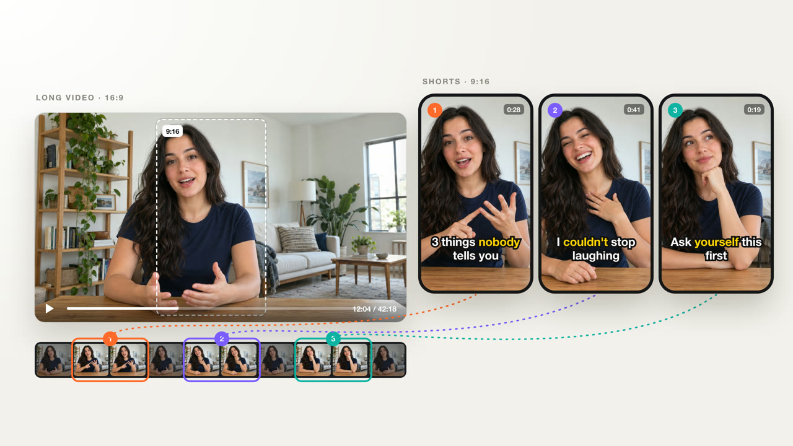
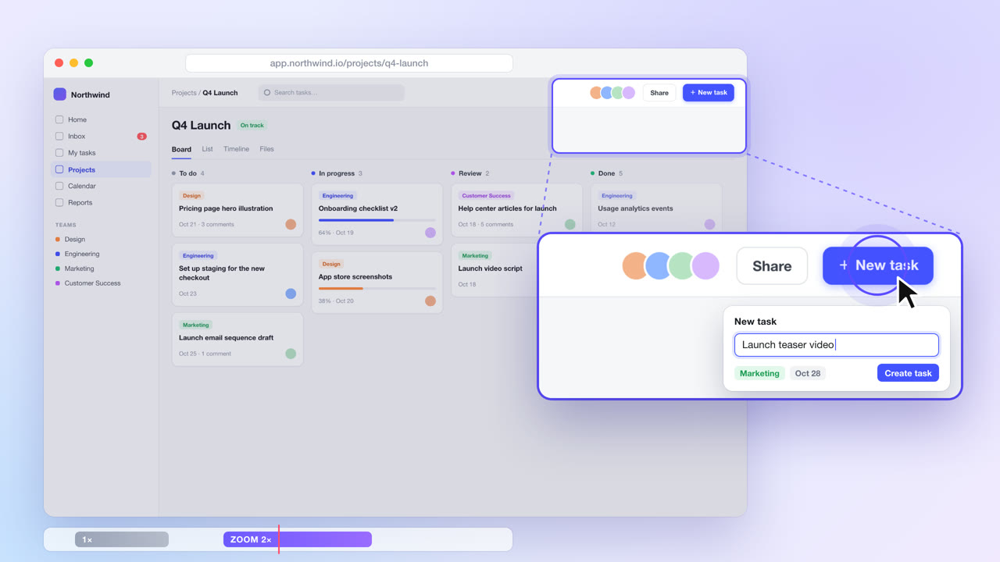
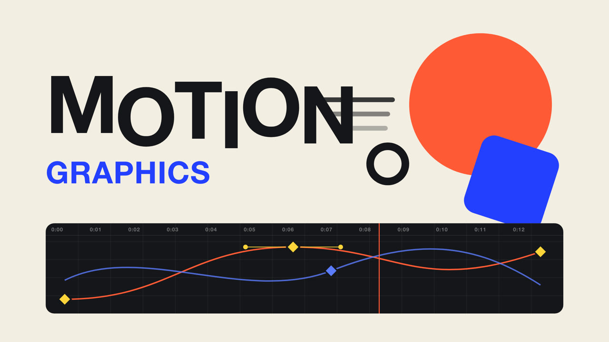
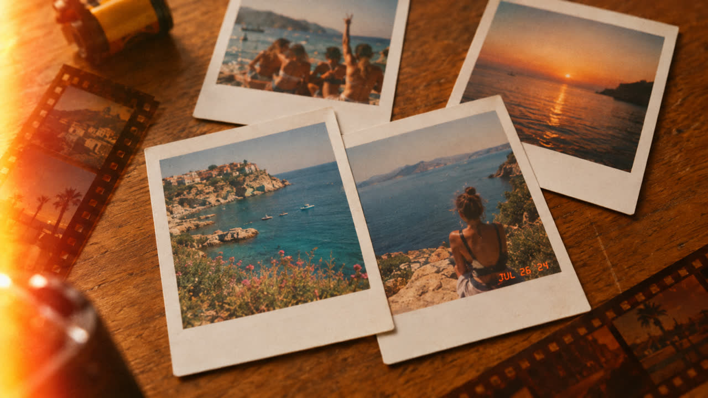
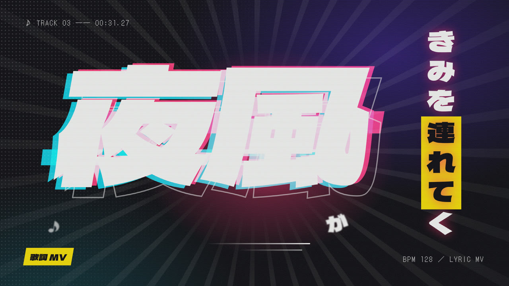
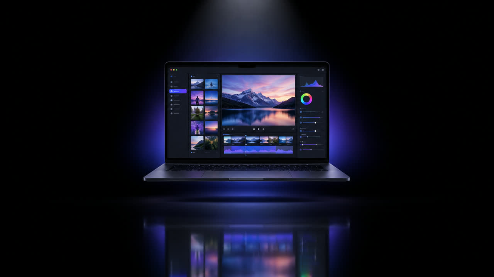
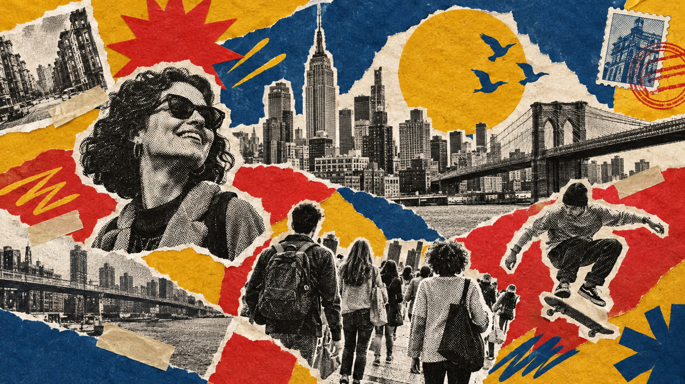

# OpenFilm skills

The skills that come with [OpenFilm](https://github.com/openfilm/openfilm). A skill is a brief for the agent making a
kind of film: what the film must achieve, the few things that must be true, and what OpenFilm offers for it. How to make
the film is the agent's craft; no skill says it.

## Workflows

| | | |
| --- | --- | --- |
|  | [Replicate a video](skills/replicate) | A video remade in OpenFilm: frame for frame, or with your own content. |
|  | [Long video to shorts](skills/long-to-short) | A talk, podcast or livestream cut into vertical clips that each stand alone. |
|  | [Screen demo](skills/screen-demo) | A screen recording made into a polished demo of the real product. |
|  | [Premium motion graphics](skills/motion-graphics) | An explainer, promo or intro at studio level, made for its subject alone. |
|  | [Presenter in a window](skills/presenter-pip) | The content fills the screen as you say it; you speak from a small window. |

## Styles

| | | |
| --- | --- | --- |
|  | [Whiteboard explainer](skills/whiteboard) | A voice explains while the board is drawn, mark by mark, as it speaks. |
|  | [Vintage film](skills/vintage-film) | Your photos and clips as a memory film, as if found on an old reel. |
|  | [Lyric video](skills/lyric-video) | A lyric video made for one song, every word landing on the voice. |
|  | [Keynote](skills/keynote) | A launch film with your real product on stage, one claim at a time. |
|  | [Cut-paper collage](skills/collage) | Motion graphics made of photos, paper and print, cut out and put together. |

## Use them

- **In OpenFilm**: they come with it. Pick one in the chat, or name it in a message.
- **In your own agent** (Claude Code, Codex and others): add OpenFilm, then these.

  ```sh
  npx skills add openfilm/openfilm
  npx skills add openfilm/skills
  ```

- **Your own**: [SPEC.md](SPEC.md) says how a skill for OpenFilm is written. OpenFilm adds one from a folder or a link,
  or makes one with you.

Each skill has its own version, in its `openfilm.json`; [CHANGELOG.md](CHANGELOG.md) says what changed and why.

## License

[MIT](LICENSE). The covers are by the OpenFilm contributors, under the same license.
